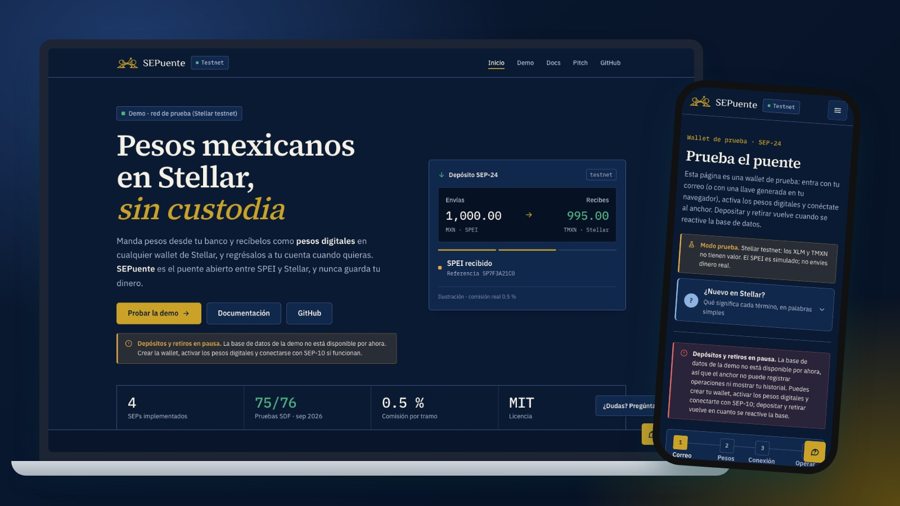
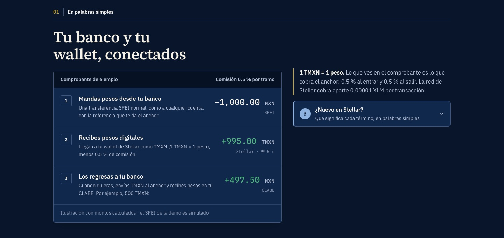
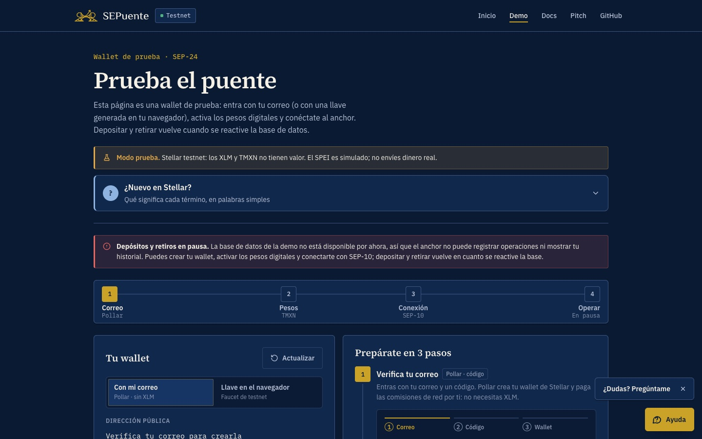
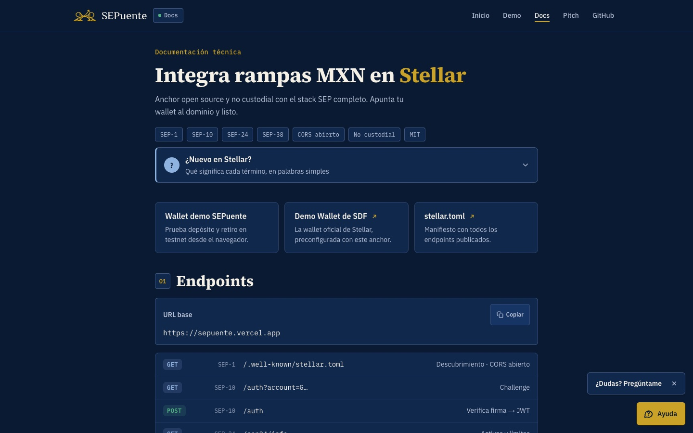
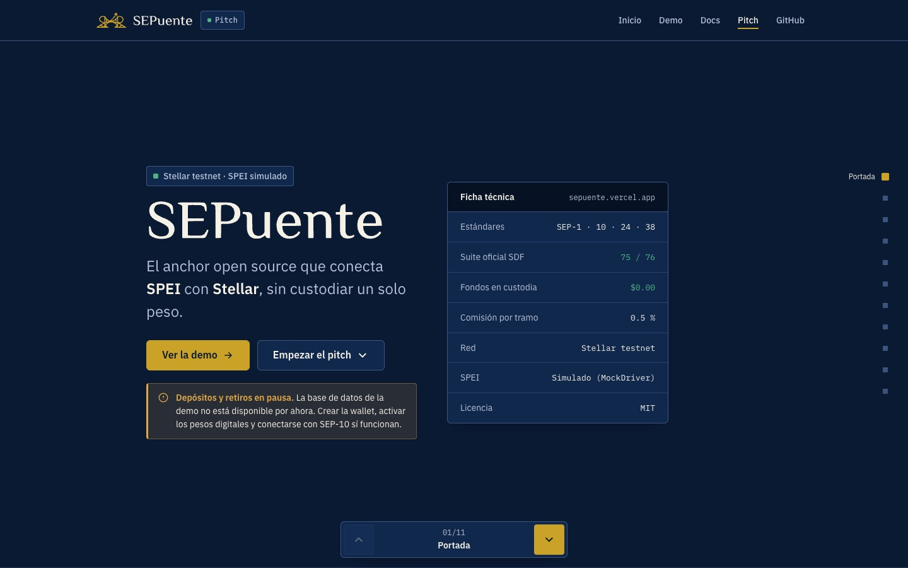
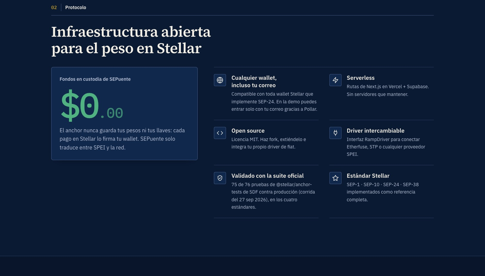
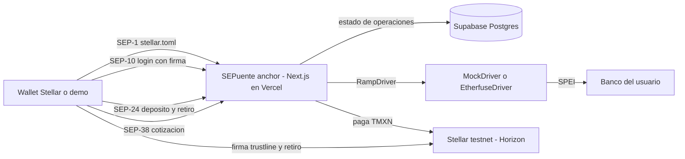

<div align="center">


# SEPuente

### Pesos mexicanos en Stellar, sin custodia: la capa open source que convierte SPEI en una rampa estándar SEP-24.

[](https://sepuente.vercel.app)
[](#-goya-hack--criptounam-2026)
[](LICENSE)


<br/>

-2ea44f)


<br/>



**[▶ Probar la demo](https://sepuente.vercel.app/demo)** · **[Documentación](https://sepuente.vercel.app/devs)** · **[Pitch](https://sepuente.vercel.app/pitch)** · **[Referencia técnica](docs/TECNICO.md)**

</div>

> [!WARNING]
> **Estado (nov 2026):** la base de datos de producción (Supabase) está apagada, así que en https://sepuente.vercel.app **los depósitos y retiros están en pausa**. La demo lo avisa y desactiva esos botones, `/sep24/info` los anuncia deshabilitados y los endpoints que dependen de la base responden `503`. Siguen funcionando SEP-1 (`stellar.toml`), SEP-10 (login), las cotizaciones indicativas de SEP-38 (`/sep38/info`, `/price`, `/prices`), el faucet de XLM de testnet y la trustline de TMXN. Todo lo de abajo describe el proyecto tal como se entregó y se verificó el 27 sep 2026; para correrlo completo basta una base nueva con `supabase/` y las variables de entorno.

---

## 🎯 El problema

Una wallet de Stellar que quiere ofrecer **pesos mexicanos** (remesas, pagos a freelancers) tiene que integrar la API propietaria de cada banco o proveedor SPEI, y muchas veces custodiar el dinero de sus usuarios. México recibió más de 60 mil millones de dólares en remesas en 2023 (Banxico), pero no existía una rampa MXN abierta y estándar para el ecosistema.

## 💡 La solución

**SEPuente es un anchor no custodial**: implementa los estándares de Stellar (SEP-1, 10, 24 y 38) encima de una rampa SPEI. Cualquier wallet compatible se conecta solo con el dominio (`stellar.toml`) y ofrece depósitos y retiros en pesos **sin que SEPuente guarde fondos ni llaves**: cada pago en Stellar lo firma la wallet del usuario.

**En una frase:** mandas pesos desde tu banco por SPEI y los recibes como pesos digitales (TMXN, 1 TMXN = 1 peso de prueba) en cualquier wallet de Stellar, y de regreso.

<div align="center">

<br/><sub>Ejemplo de la página de inicio, con la comisión real de 0.5 % por tramo. El SPEI de la demo es simulado.</sub>
</div>

## 🔁 Cómo funciona

1. **Descubrimiento (SEP-1):** la wallet lee `/.well-known/stellar.toml` y encuentra los endpoints y el activo TMXN.
2. **Login (SEP-10):** la wallet firma un reto y recibe un JWT.
3. **Depósito o retiro (SEP-24):** SEPuente abre su pantalla interactiva dentro de la wallet, pide el monto, muestra la cotización (SEP-38) y entrega la CLABE y la referencia SPEI.
4. **Liquidación:** el driver detecta el SPEI y el anchor paga TMXN a la wallet; en el retiro, la wallet paga TMXN al anchor con memo y el driver manda los pesos a la CLABE.

El SPEI lo hace un **driver intercambiable** (`RampDriver`): `MockDriver` (testnet, "Simular SPEI" envía TMXN real) y `EtherfuseDriver` (escrito, no probado sin API key).

## ✨ Funciones principales

<table>
<tr>
<td width="50%"><br/><b>Wallet de prueba</b> (<code>/demo</code>): entra con tu correo vía Pollar o con una llave generada en el navegador, activa TMXN, conéctate por SEP-10 y opera. El flujo SEP-24 se abre en una hoja dentro de la misma página.</td>
<td width="50%"><br/><b>Documentación para wallets</b> (<code>/devs</code>): URL base, todos los endpoints SEP y enlaces a la Demo Wallet de SDF y al <code>stellar.toml</code>.</td>
</tr>
<tr>
<td width="50%"><br/><b>Pitch por capítulos</b> (<code>/pitch</code>): narrativa con barra de progreso, navegación por teclado y ficha técnica.</td>
<td width="50%"><br/><b>No custodial y abierto:</b> $0 en custodia, licencia MIT, compatible con cualquier wallet SEP-24 y un driver para conectar otro proveedor SPEI.</td>
</tr>
</table>

También incluye un **chat de ayuda con 19 respuestas predeterminadas** (rotulado "no es IA") que sabe en qué paso de la demo vas, modo claro y oscuro, y logo 3D con three.js.

## 🏗️ Arquitectura



El flujo paso a paso (diagrama de secuencia), los drivers, la lista de endpoints y las variables de entorno están en **[docs/TECNICO.md](docs/TECNICO.md)**.

## 🏆 GOYA HACK · CriptoUNAM 2026

| | |
|---|---|
| **Track** | Blockchain |
| **Sponsors** | Stellar · BAF · Pollar (login por correo, trustline, firma SEP-10 y pago del retiro en la demo) |
| **Demo** | https://sepuente.vercel.app (wallet de prueba en `/demo`, pitch en `/pitch`, docs en `/devs`) |
| **Red** | Stellar Testnet · activo `TMXN` (1 TMXN = 1 peso de prueba) |
| **Equipo** | [ALFA117](https://github.com/ALFA117) |

**Qué se verificó en producción el 27 sep 2026:**
- Flujo completo de depósito y retiro en testnet, con transacciones reales visibles en stellar.expert (`node scripts/e2e-testnet.mjs https://sepuente.vercel.app`; hoy se detiene en el depósito con `503` porque la base está apagada).
- **75 de 76 pruebas oficiales de SDF (`@stellar/anchor-tests`)** en SEP-1, 10, 24 y 38 contra producción. La única restante mide la hora del reto SEP-10 contra el reloj de la computadora que corre la prueba ([detalle](docs/TECNICO.md#validación-con-anchor-tests)).
- SPEI simulado y marcado como "Modo prueba" en toda la interfaz (`DRIVER=mock`).

<details>
<summary><b>Para jueces: los 4 criterios en un minuto</b></summary>

**1 · Ejecución técnica: corre en Stellar testnet.**

| Qué | En stellar.expert |
|---|---|
| Depósito: el anchor paga 248.75 TMXN a una wallet | [`53cb393e…8ded5db`](https://stellar.expert/explorer/testnet/tx/53cb393ef250d27119a5a5ed6caef0e41be889a45f2d1edb81b3c361e8ded5db) |
| Retiro: la wallet paga 100 TMXN al anchor con memo | [`555c38ce…91aac3b6`](https://stellar.expert/explorer/testnet/tx/555c38ce6eae6238300c7d8806e28339961c741c6a3e89714ee07dbe91aac3b6) |
| Emisor del activo TMXN | [`GAIEJKMT…FX63UG`](https://stellar.expert/explorer/testnet/account/GAIEJKMT4RMRLTZ22KI7TMANXETIWO4T2H5RZG3MZDJKXDDLM4FX63UG) |
| Cuenta de distribución del anchor | [`GC2UNTIN…IS3MGE2`](https://stellar.expert/explorer/testnet/account/GC2UNTINTDLHZE6UYO5JPTT5DAJ3Y6GYF7TPE2V5KCO2BJFX3IS3MGE2) |
| Descubrimiento SEP-1 | [`/.well-known/stellar.toml`](https://sepuente.vercel.app/.well-known/stellar.toml) |

Son de la corrida completa contra producción del 27 sep 2026. Con la base de datos activa, para generar las tuyas abres [`/demo`](https://sepuente.vercel.app/demo), completas los 3 pasos y haces un depósito; el historial enlaza cada pago a stellar.expert.

**2 · Ajuste producto-problema: por qué Stellar.**
- **Usuario:** una wallet o app de Stellar que quiere ofrecer pesos mexicanos (remesas, pagos a freelancers). **Tarea:** agregar depósito y retiro por SPEI sin integrar la API de cada banco ni custodiar fondos.
- **Por qué Stellar:** anchors y SEP-24 son el estándar de rampas de Stellar; una wallet integra una vez y funciona con cualquier anchor, y SEPuente se descubre solo con `stellar.toml`. Emitir el peso (TMXN) es nativo, con trustline, sin contrato ni puente. La liquidación tarda unos 5 s y cuesta 0.00001 XLM, viable para montos chicos.

**3 · Impacto: quién se beneficia.**
- La persona en México que recibe dinero en su wallet y necesita pesos en su CLABE.
- Las wallets del ecosistema Stellar, que obtienen una rampa MXN abierta (MIT) sin depender de un proveedor.
- La comunidad UNAM: el código es MIT y un `RampDriver` nuevo basta para conectar otro proveedor SPEI.

**4 · Demostración y claridad.**
- Video (≤ 3 min): guion en [`VIDEO.md`](VIDEO.md).
- Repositorio público, licencia MIT. Todo el trabajo propio se hizo durante el hackathon (primer commit: 25 sep 2026).

</details>

## 🆚 Diferenciación

| Proyecto | Qué hace | Por qué no es SEPuente |
|---|---|---|
| **Ramp Kit** | SDK que cada app integra directamente | No expone servidor SEP-24; cada app implementa la capa |
| **StellarMesh** | Mismo patrón SEP-24 pero para saldos de exchanges | No conecta rampas SPEI/fiat |
| **Anchor Platform / Anchor in a Box (SDF)** | Para convertirse en anchor propio desde cero | Requiere infraestructura propia y KYC propio |
| **SEPuente** | Adaptador ligero para rampas ya reguladas sin cambiarlas | No custodial: el KYC y el dinero se quedan en el proveedor |

## 🛠️ Stack

| Capa | Tecnología |
|:--|:--|
| Web y API | Next.js 15 (App Router y rutas API) · React 18 · TypeScript |
| Stellar | `@stellar/stellar-sdk` (Horizon, SEP-10 `WebAuth`) · Friendbot · Stellar testnet |
| Autenticación | `jose` (JWT de SEP-10) · Pollar (`@pollar/core`, wallet con verificación de correo, opcional) |
| Datos | Supabase (Postgres con RLS) |
| Interfaz | CSS Modules con tokens · Motion · three.js (logo 3D) |
| Rampa | `MockDriver` · `EtherfuseDriver` (no probado sin API key) |
| Hosting | Vercel |

## 🚀 Correrlo en tu compu

<details>
<summary><b>Instalación paso a paso</b></summary>

```bash
# 1. Clonar e instalar
git clone https://github.com/ALFA117/sepuente
cd sepuente
npm install

# 2. Configurar entorno
cp .env.example .env.local
# Edita .env.local con tus claves de Supabase y JWT_SECRET

# 3. Generar cuentas testnet (imprime variables para .env.local)
npm run setup-testnet

# 4. Crear tablas en Supabase
# Pega el contenido de supabase/migrations/001_initial.sql en el SQL editor

# 5. Levantar en local
npm run dev
# Abre http://localhost:3000

# 6. Probar con Demo Wallet SDF
# https://demo-wallet.stellar.org/?home_domain=localhost:3000
```

Prueba de punta a punta contra un deploy: `node scripts/e2e-testnet.mjs <url>`. Validación con la suite oficial de SDF: ver [docs/TECNICO.md](docs/TECNICO.md#validación-con-anchor-tests).

</details>

## 🗺️ Roadmap

- **Q1 2027:** KYC por usuario, SEP-6, webhooks firmados, auditoría de seguridad independiente, segunda rampa MXN regulada.
- **Q2 2027:** piloto en mainnet, ruteo entre rampas con SEP-38, soporte de smart wallets (SEP-45).

## 📂 Documentación

- [docs/TECNICO.md](docs/TECNICO.md): flujo SEP-24 en diagrama de secuencia, anchor-tests, drivers, endpoints y variables de entorno.
- [docs/NOTAS.md](docs/NOTAS.md): bitácora de auditoría móvil, bugs corregidos y notas de diseño.
- [VIDEO.md](VIDEO.md): guion del video de demostración.

## 🙌 Código y herramientas reutilizados

Todo el trabajo propio se construyó durante el hackathon (primer commit: 25 sep 2026). Se reutilizó:

- **Librerías y plataformas:** [Next.js](https://nextjs.org), [@stellar/stellar-sdk](https://github.com/stellar/js-stellar-sdk), [jose](https://github.com/panva/jose), [Supabase](https://supabase.com), [Vercel](https://vercel.com), [Motion](https://motion.dev), [three.js](https://threejs.org), Google Fonts vía `next/font` (Source Serif 4, Inter, JetBrains Mono), [Etherfuse](https://etherfuse.com) (driver no probado), [Pollar](https://pollar.xyz) (`@pollar/core`, Apache-2.0; modo opcional de `/demo`, el anchor no depende de Pollar).
- **Herramientas:** [anchor-tests (SDF)](https://github.com/stellar/stellar-anchor-tests), [Demo Wallet (SDF)](https://demo-wallet.stellar.org), [potrace](https://www.npmjs.com/package/potrace) (vectorización del logo), [Friendbot](https://developers.stellar.org/docs/learn/fundamentals/networks#friendbot).
- **Asistentes de IA:** Claude (Anthropic), vía Claude Code: generación y revisión de código, diseño de interfaz, pruebas y documentación.

## 📄 Licencia

[MIT](LICENSE): úsalo, forkéalo, mejóralo. Pull requests bienvenidos.

---

<div align="center">

**El producto es la capa de estándares. La app de demo es solo un cliente más.**

<sub>Hecho por <a href="https://github.com/ALFA117">ALFA117</a> para GOYA HACK · CriptoUNAM 2026 · Stellar testnet</sub>

</div>
