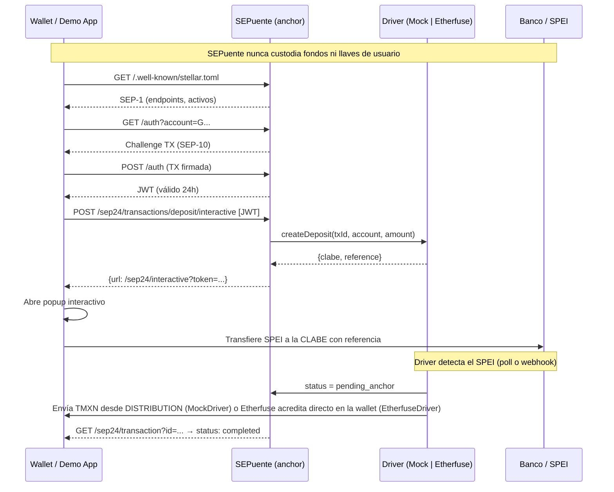

# Referencia técnica de SEPuente

[← Volver al README](../README.md)

## Flujo (Mermaid)




## Validación con anchor-tests

La suite oficial de SDF necesita una cuenta con transacciones reales en cada estado (depósito pendiente y completado, retiro esperando pago y completado). El script las crea en testnet y escribe la configuración; la llave es de una cuenta desechable, así que guarda el archivo fuera del repo.

```bash
node scripts/make-anchor-test-config.mjs https://sepuente.vercel.app ./sep-config.json
npx -p @stellar/anchor-tests stellar-anchor-tests --home-domain sepuente.vercel.app --seps 1 10 24 38 --sep-config ./sep-config.json
```

**Resultado en producción (27 sep 2026): 75 de 76.**

| SEP | Resultado |
|---|---|
| SEP-1 stellar.toml | 5/5 |
| SEP-10 Web Auth | 16/17 |
| SEP-24 Hosted deposit/withdraw | 38/38 |
| SEP-38 Quotes | 18/18 (contexto `sep6`; esta versión de la suite no admite `sep24`) |

La prueba restante ("returns a valid GET /auth response") exige que el `minTime` del reto caiga entre el segundo de envío y el de recepción **según el reloj de la máquina que corre la prueba**. El anchor usa la hora del servidor (Vercel, sincronizado por NTP); la computadora donde se corrió iba 0.9 s atrasada respecto a `time.windows.com`. Con un reloj sincronizado la prueba pasa; adelantar o atrasar el `minTime` en el servidor la rompería para cualquier evaluador con la hora correcta.

Qué se corrigió para llegar ahí (de 17/61 a 75/76): `POST /auth` aceptaba solo JSON (SEP-10 exige también formulario), la verificación ignoraba los firmantes y umbrales reales de la cuenta (multisig), `/sep24/info` enviaba montos como texto, faltaban validaciones de `asset_code`/`account`, búsquedas por `stellar_transaction_id`/`external_transaction_id`, filtros de `/transactions` (`no_older_than`, `kind`, `paging_id`), montos esperados en operaciones en curso, la página `more_info_url`, y en SEP-38 las fórmulas de precio (`total_price = sell / buy`), los métodos de entrega SPEI y que `GET /quote/:id` devolviera exactamente lo mismo que al crearla.


## Arquitectura

- **Framework**: Next.js 15 App Router + TypeScript, desplegable en Vercel Hobby
- **Persistencia**: Supabase (tier gratuito) con RLS habilitado
- **Stellar**: Horizon testnet + Friendbot
- **Estado**: todo en Supabase; pull-on-read (sin procesos en background)
- **Secretos**: exclusivamente en rutas de servidor (SIGNING_SECRET_KEY, ISSUER_SECRET_KEY, DISTRIBUTION_SECRET_KEY, JWT_SECRET, SUPABASE_SERVICE_ROLE_KEY)
- **CORS**: `Access-Control-Allow-Origin: *` en todos los endpoints SEP

### Drivers

| Driver | Activar | Uso |
|---|---|---|
| `MockDriver` | `DRIVER=mock` (default) | Testnet puro; "Simular SPEI" envía TMXN real |
| `EtherfuseDriver` | `DRIVER=etherfuse` | Sandbox de Etherfuse; SPEI → CETES tokenizados |

---

## SEPs implementados

| SEP | Endpoint(s) |
|---|---|
| SEP-1 | `GET /.well-known/stellar.toml` |
| SEP-10 | `GET /auth`, `POST /auth` |
| SEP-24 | `GET /sep24/info`, `POST /sep24/transactions/{deposit,withdraw}/interactive`, `GET /sep24/transaction`, `GET /sep24/transactions` + UI `/sep24/interactive` |
| SEP-38 | `GET /sep38/info`, `GET /sep38/prices`, `GET /sep38/price`, `POST /sep38/quote`, `GET /sep38/quote/:id` |


## Variables de entorno

| Variable | Descripción |
|---|---|
| `SIGNING_PUBLIC_KEY` / `SIGNING_SECRET_KEY` | Cuenta para challenge SEP-10 (sin fondos necesarios) |
| `ISSUER_PUBLIC_KEY` / `ISSUER_SECRET_KEY` | Emisor del activo TMXN |
| `DISTRIBUTION_PUBLIC_KEY` / `DISTRIBUTION_SECRET_KEY` | Distribuidor; paga TMXN a usuarios en depósito (MockDriver) |
| `ASSET_CODE` | Código del activo (default: `TMXN`) |
| `JWT_SECRET` | Secreto para firmar tokens SEP-10 |
| `JWT_EXPIRY` | Duración del JWT en segundos (default: 86400) |
| `NEXT_PUBLIC_SUPABASE_URL` | URL del proyecto Supabase |
| `NEXT_PUBLIC_SUPABASE_ANON_KEY` | Anon key pública |
| `SUPABASE_SERVICE_ROLE_KEY` | Service role (solo servidor) |
| `DRIVER` | `mock` o `etherfuse` |
| `ETHERFUSE_API_KEY` | Solo si `DRIVER=etherfuse` |
| `NEXT_PUBLIC_APP_URL` | URL del deploy (sin trailing slash, siempre HTTPS) |
| `NEXT_PUBLIC_ASSET_CODE` / `NEXT_PUBLIC_ISSUER_PUBLIC_KEY` | Código y emisor del token para la wallet demo (públicos) |
| `NEXT_PUBLIC_POLLAR_PUBLISHABLE_KEY` | Opcional. Llave publicable de Pollar (`pub_testnet_…`) para entrar a la demo con correo; sin ella solo aparece la wallet con llave en el navegador |

